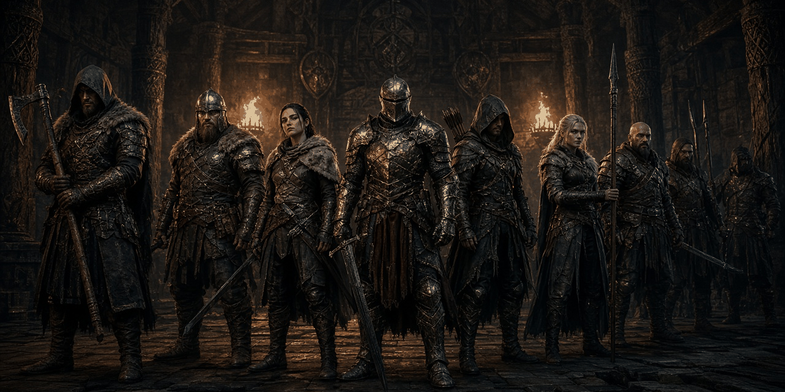

# Sellsword Roster

Steel for hire, by name. Sellsword Roster is a small Skyrim Special Edition mod with eight named sellswords. Each one has a background, a trait and a daily wage, and a few of them are looking for work each week. Hire one with a lesser power. They follow you through the vanilla follower system, and they leave if you stop paying.

**Status: v0.1.0, early beta.** It passes every automated check in the build (Papyrus compile, plugin validation, byte-exact round trip, SEQ check, FOMOD schema, cross-mod compatibility check) but has not been playtested in game yet. Expect rough edges and please report what you find. See [docs/TESTING.md](docs/TESTING.md).

- Game: Skyrim Special Edition / Anniversary Edition 1.6.x (1.5.97 also works). Runs on Windows, and on Linux through Proton.
- Requirements: just the base game. No SKSE, SkyUI, DLC or Creation Club content.
- Plugin: `SellswordRoster.esp`, ESL-flagged, with Skyrim.esm as its only master. **It edits no vanilla records and places nothing in the world.** A sellsword only exists once you hire them.
- Works with the rest of the series ([Blackshield Company](https://github.com/synthalorian/blackshield-company), [Bounties of Oblivion](https://github.com/synthalorian/bounties-of-oblivion), [Contract Hunter](https://github.com/synthalorian/contract-hunter), [Steel Oath](https://github.com/synthalorian/steel-oath), [Ember Smithing](https://github.com/synthalorian/ember-smithing), [The Gray-Mane Debt](https://github.com/synthalorian/the-gray-mane-debt), [Blackshield Codex](https://github.com/synthalorian/blackshield-codex), [War Banners](https://github.com/synthalorian/war-banners), [Roadwarden](https://github.com/synthalorian/roadwarden)). It has its own prefix (`SSR_`), records, globals and files, and it is checked by loading all ten plugins together (see [tools/modkit](tools/modkit/README.md)).

## The roster

| Sellsword | Trait | Wage / day |
|---|---|---|
| Hroki Stone-Arm (Nord) | Shield-Brother: +50 armor | 40 |
| Vala the Red (Nord) | Bloodhound: weapon attacks do 25% more damage | 50 |
| Septimus Varo | Iron Lungs: +50 stamina, stamina regenerates 50% faster | 35 |
| Ilsa Brightwater | Field Medic: health regenerates twice as fast | 45 |
| Durak gro-Bagol (Orc) | Thick Hide: 25% magic resistance | 60 |
| Ash-Eye (archer) | Deadeye: +25 Archery | 45 |
| Bram the Mule | Pack Mule: +150 carry weight | 30 |
| Liv Quickstep | Fleet-Footed: moves 15% faster | 35 |

Each sellsword's looks, voice, level, skills and gear come from a vanilla leveled bandit template of their race and sex (the Orc from the bandit chief template, Ash-Eye from the bandit archer template). Their name, factions, behaviour and trait are their own: they aren't bandits and nobody treats them as bandits. A sellsword's face and gear are picked the first time you hire them, and they stay the same after that.

## How it works

1. After the opening (once you're out of Helgen), you learn the lesser power **Sellsword Roster**, and a short note explains it.
2. Use the power. The roster shows who is looking for work **this week** (3 of the 8, changing every 7 days). Pick a name to read their background, trait and wage, then **Hire** or go **Back**.
3. Hiring costs the first day's wage. The sellsword appears beside you and becomes your follower through the **vanilla follower system**: follow, wait, trade, favors, and "time to part ways" all work as normal.
4. **Wages:** every 24 game hours from the moment you hired them, the wage is taken from your gold ("Hroki collects 40 gold in wages."). If you can't pay, the debt carries over to the next payday. **Miss two paydays in a row and they leave**, and they won't work for you again for 14 days.
5. **Dismissing** a sellsword (dialogue, or the power's "Release them") puts them back on this week's roster. When you leave the area they head off, and they look the same the next time you hire them.
6. **Death is permanent.** The roster just gets one name shorter.

Using the power while you have a sellsword shows when the next wage is due, with options to show the roster or release them.

### One follower at a time

The vanilla follower system allows **one** human follower. A roster sellsword takes that slot, the same as Lydia, a hireling, or the **Blackshield Company's sellsword**. If you already have a follower, the roster tells you to part ways with them first. The two mods share no records. They just both use the vanilla slot. Multiple-follower mods that hook the vanilla system may lift the limit, but that hasn't been tested.

### Settings (console)

```
set SSR_RotationDays to 7        ; days between roster changes
set SSR_RosterSize to 3          ; how many are looking for work each week (1-8)
set SSR_WageMult to 100          ; percent applied to every wage
set SSR_GraceDays to 1           ; paydays you can miss before they leave
set SSR_LeaveCooldownDays to 14  ; how long an unpaid sellsword refuses work
set SSR_PollSeconds to 5         ; how often the script checks your sellsword (real seconds)
```

Read-only: `SSR_HiredIndex` (-1 or 0-7), `SSR_WagesPaid` (gold paid so far), `SSR_Avail01`-`08` (who is on this week's roster).

## Known issues (early beta)

- **No new dialogue.** The sellswords use the vanilla follower lines for their voice type, and those come from the bandit templates. Most bandit voice types have follower lines, but not all of them do. If one of them is silent or has no follower dialogue, please report which one. Hiring happens through the power, not by talking to them.
- Wages are counted from the hour you hired, not at a fixed time of day.
- When a dismissed sellsword leaves, they are disabled once you are about 40 m away. They don't walk to an inn.
- The roster changes when you open it after the 7 days are up, not exactly on day 7.
- The traits are fixed per sellsword. There's no leveling or perks.

## Building

`./build.sh` on Linux builds the release zip from this repo. Papyrus is compiled with the open-source [papyrus-compiler](https://github.com/russo-2025/papyrus-compiler), the plugin is generated from C# with [Mutagen](https://github.com/Mutagen-Modding/Mutagen), and everything is validated. You need .NET SDK 9+, python3, curl and, optionally, xmllint. See [tools/modkit/README.md](tools/modkit/README.md).

The ten-mod compatibility report is in [tools/modkit/compat-report.md](tools/modkit/compat-report.md).

## Layout

```
src/plugin/SellswordRoster.Generator/   C# generator (sellswords, traits, power, messages, controller quest, settings)
src/plugin/formids.json                 pinned FormIDs
src/papyrus/                            roster controller, power, player alias and sellsword alias scripts
fomod/                                  FOMOD installer config
tools/modkit/                           shared build tooling (Mutagen helpers, validator, Papyrus, FOMOD, compat check)
docs/                                   design notes, testing checklist, Nexus page
```

## Credits

- Built with [Mutagen](https://github.com/Mutagen-Modding/Mutagen) and [russo-2025/papyrus-compiler](https://github.com/russo-2025/papyrus-compiler).
- The sellswords' looks and voices are vanilla Skyrim.esm templates. The mod ships no Bethesda assets.

## Support

Donations are optional. Nothing in the mod is gated on them.

- GitHub Sponsors: https://github.com/sponsors/synthalorian
- Ko-fi: https://ko-fi.com/synthalorian

## License

MIT (code and text in this repository). See [LICENSE](LICENSE).

## Support

Donations are optional. Nothing in the mod is gated on them.

- GitHub Sponsors: https://github.com/sponsors/synthalorian
- Ko-fi: https://ko-fi.com/synthalorian

<p><br><sub>A <a href="https://github.com/Blackshield-Company">Blackshield Company</a> mod.</sub></p>
